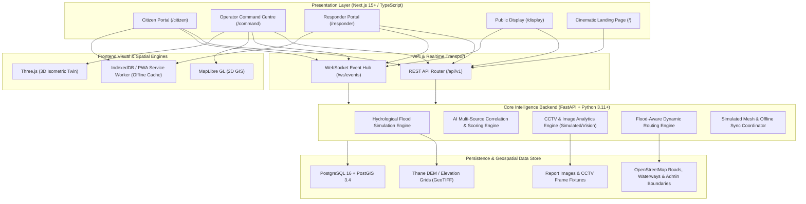
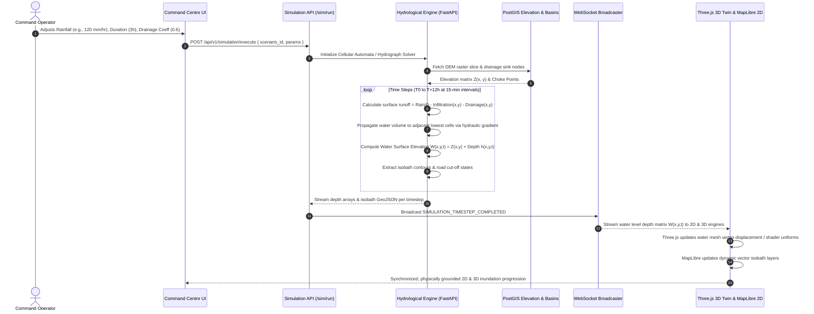
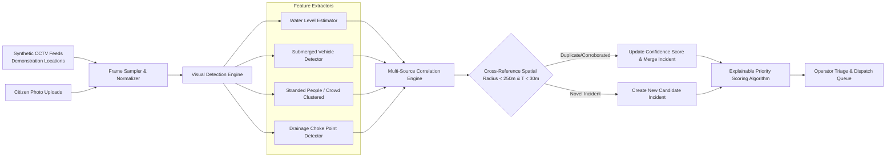
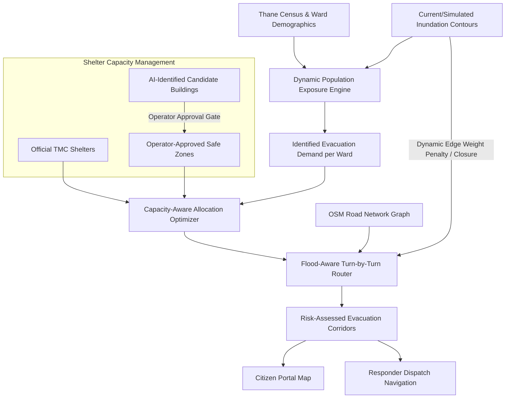
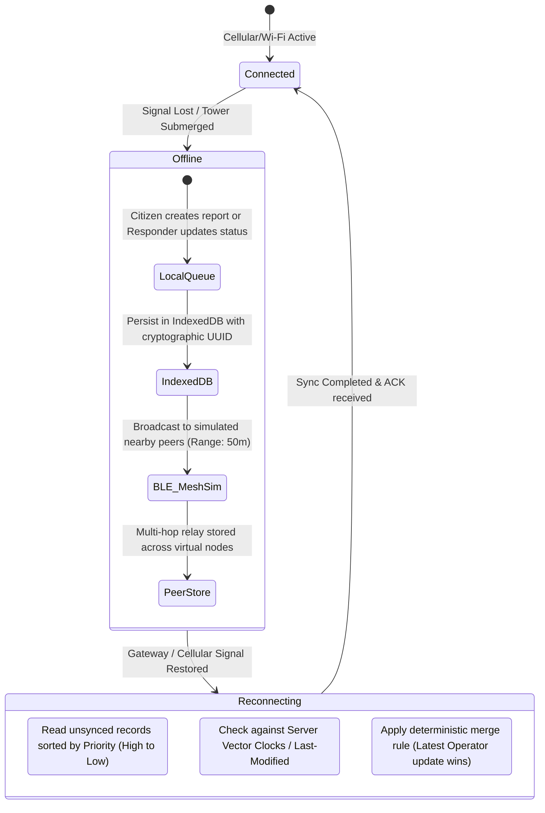

# DISAS — System Architecture & Technical Specifications

## 1. Architectural Overview

DISAS is designed as a decoupled, modern multi-tier platform combining a high-performance Python FastAPI geospatial backend with a responsive Next.js frontend application. The platform leverages PostgreSQL with the PostGIS spatial extension as its core source of truth and incorporates real-time WebSocket communication for live event distribution across all four operational portals.



---

## 2. Technology Stack & Component Specifications

| Layer / Subsystem | Technology | Purpose & Rationale |
| :--- | :--- | :--- |
| **Frontend Framework** | **Next.js 15 (App Router) + TypeScript** | Server and client component rendering, high-performance page transitions, typed contracts across all interfaces. |
| **Styling & UI Primitives** | **Tailwind CSS + shadcn/ui + Lucide Icons** | Utility-first styling for the Liquid Glass aesthetic; accessible, unstyled UI primitives. |
| **2D Mapping & GIS** | **MapLibre GL JS** | Open-source, vector tile rendering, zero vendor lock-in, GPU-accelerated layer manipulation for flood isobaths and road closures. |
| **3D Isometric Engine** | **Three.js + Custom Shaders** | Procedural terrain geometry, miniature-city isometric twin rendering, animated water plane mesh, orthographic camera controls. |
| **Local Persistence / Offline** | **IndexedDB + Dexie.js / PWA** | Client-side queue for pending citizen reports, offline tile storage, and message reconciliation. |
| **Backend API Framework** | **FastAPI (Python 3.11+)** | High-throughput asynchronous endpoints, automatic OpenAPI schema generation, direct interoperability with Python scientific libraries. |
| **Realtime Transport** | **FastAPI WebSockets + Redis/In-Memory PubSub** | Sub-second propagation of citizen alerts, simulated sensor updates, and operator dispatches. |
| **Spatial Database** | **PostgreSQL 16 + PostGIS 3.4** | Spatial indexing (`GIST`), topological routing queries, polygon containment, raster-to-vector extraction. |
| **Geospatial Processing** | **GeoPandas, Rasterio, Shapely, PyProj** | DEM elevation grid slicing, rainfall runoff hydrograph calculation, Voronoi safe zone partitioning. |
| **Containerization** | **Docker & Docker Compose** | Reproducible multi-service development environment encapsulating PostGIS, backend, and frontend. |
| **Cloud Hosting Profile** | **Railway (Optional Hackathon Deploy)** | Single-click container deployment with managed PostgreSQL/PostGIS. |

---

## 3. Core Subsystem Architectures

### 3.1 Flood Simulation Subsystem & 3D Twin Coupling

The flood simulation engine operates on a coupled hydrological grid-elevation model tailored to Thane's topography, directly driving both the 2D GIS visualization and the 3D Three.js isometric digital twin.



#### Physical Model & Mathematical Coupling
1. **Hydrological Mass Balance per Grid Cell $(x, y)$:**
   $$\Delta V_{\text{surface}}(x, y, t) = \left[ R(t) - I(x, y) - D(x, y) \right] \cdot \Delta A + \sum Q_{\text{in}}(x, y, t) - \sum Q_{\text{out}}(x, y, t)$$
   Where:
   - $R(t)$ is rainfall intensity input (mm/hr converted to $\text{m/s}$).
   - $I(x, y)$ is infiltration loss rate based on urban soil/impervious surface classification.
   - $D(x, y)$ is stormwater drainage capacity (reduced at high tide along Thane Creek).
   - $\Delta A$ is grid cell area ($10\text{m} \times 10\text{m}$ or $30\text{m} \times 30\text{m}$).
   - $Q_{\text{in}}, Q_{\text{out}}$ represent inter-cell gravitational flux driven by the hydraulic gradient between adjacent cells:
     $$S_f = \frac{W(x_1, y_1, t) - W(x_2, y_2, t)}{\Delta L}$$

2. **Coupling to Water Surface Elevation & 3D Twin Rendering:**
   $$\text{Water Surface Elevation } W(x, y, t) = Z_{\text{terrain}}(x, y) + h(x, y, t)$$
   Where:
   - $Z_{\text{terrain}}(x, y)$ is the digital terrain elevation from the DEM.
   - $h(x, y, t)$ is the calculated water inundation depth.
   - **3D Isometric Twin Binding:** The Three.js digital twin does not use detached, decorative water animations. Instead, the water plane mesh or heightfield shader directly samples $W(x, y, t)$. When $h(x, y, t) \le 0$, the cell is rendered dry; when $h(x, y, t) > 0$, the water geometry displaces upward to exact elevation $W(x, y, t)$ with dynamic depth-based opacity and refraction.

#### Digital Elevation Model (DEM): Discovery, Provenance, Licensing & Fallbacks
The baseline assumption of a 10m DEM is an **unverified development assumption** subject to data availability and licensing constraints:

| Terrain Dataset Candidate | Native Resolution | Licensing / Access Terms | Source Attribution | Suitability / Fallback Role |
| :--- | :---: | :--- | :--- | :--- |
| **Copernicus DEM GLO-30** | 30m | Open Access (Copernicus WorldDEM license / free for public use) | European Space Agency (ESA) / Airbus | **Primary Fallback:** High vertical accuracy ($\approx 2\text{m}$). Resampled to 10m/15m grid cells via bilinear interpolation for simulation. |
| **NASA SRTM GL1** | 30m | Public Domain (USGS / NASA) | NASA / USGS | **Secondary Fallback:** Readily available global coverage; void-filled versions available. |
| **ALOS AW3D30** | 30m | Open under JAXA terms (attribution required) | JAXA (Japan Aerospace Exploration Agency) | Alternate global DSM reference. |
| **Survey of India / Bhuvan** | 10m – 30m | Restricted / Government Data Sharing Policy | National Remote Sensing Centre (ISRO) | Official national source; subject to administrative access delays for hackathon timeline. |
| **Synthetic Calibrated DEM** | 10m procedural | Internal DISAS Project (MIT / CC0) | DISAS Core Architecture Team | **Deterministic Zero-Dependency Fallback:** Procedural raster calibrated against known Thane elevations (Yeoor Hills 120m $\rightarrow$ Thane Creek 2m, Masunda Lake 12m). Guarantees offline, reproducible hackathon execution. |

- **Data Discovery Protocol:**
  1. Evaluate Copernicus GLO-30 GeoTIFF tile covering bounding box `[72.90°E, 19.15°N, 73.05°E, 19.28°N]`.
  2. Inspect vertical accuracy along known tidal floodplains and clip to Thane Municipal Corporation boundaries.
  3. Pre-process into localized Cloud-Optimized GeoTIFF (COG) stored in `backend/data/terrain/thane_dem_processed.tif`.
  4. If external download or license compliance fails during offline execution, automatically activate the Synthetic Calibrated DEM fallback.

- **Output Artifacts:** GeoJSON isobath polygons with `depth_cm`, categorized into 4 risk tiers:
  - `Normal`: < 15 cm (Minor curb accumulation, passable)
  - `Watch`: 15 cm – 45 cm (Passable by heavy vehicles only, pedestrian caution)
  - `Warning`: 45 cm – 90 cm (Vehicles stalled, ground floor ingress risk)
  - `Critical`: > 90 cm (Severe structural risk, rescue boat required)

---

### 3.2 CCTV Intelligence & Multi-Source Correlation Pipeline

DISAS incorporates an automated visual analysis pipeline. For the hackathon prototype, all camera feeds operate strictly at **synthetic demonstration locations** with pre-recorded/synthetic fixtures. **No connection, tap, or access to real municipal CCTV infrastructure (TMC or Traffic Police) is used or implied.**



- **Explainable Scoring Formulation:**
  $$\text{Priority Score} = w_1 \cdot \text{Depth} + w_2 \cdot \text{Population Exposed} + w_3 \cdot \text{Critical Infrastructure Proximity} + w_4 \cdot \text{Corroboration Confidence}$$
  Every calculated score includes explicit breakdown metadata:
  ```json
  {
    "score": 87.5,
    "tier": "CRITICAL",
    "factors": {
      "water_depth_cm": 85,
      "estimated_people_at_risk": 42,
      "hospital_proximity_m": 120,
      "corroboration_sources": ["CCTV_CAM_14_TEEN_HATH", "CITIZEN_REPORT_#1042"]
    },
    "reasoning": "Severe flooding (>80cm) obstructing arterial ambulance access to Jupiter Hospital with 2 corroborated visual reports."
  }
  ```

---

### 3.3 Dynamic Shelter Allocation & Flood-Aware Evacuation Routing

The shelter and routing subsystem ensures safe evacuation without routing evacuees through submerged passages.



- **Road Graph Disruption Rules:**
  - If flood depth on road segment > 45 cm, road is marked impassable for standard vehicles (edge weight $\rightarrow \infty$).
  - If flood depth > 15 cm, edge weight increases proportionally based on wading delay and risk multiplier.
  - Bridge approaches under tidal submergence are automatically severed from routing topology.
- **Safety Disclaimer Requirement:** All generated route payloads embed mandatory metadata:
  `"disclaimer": "Assessed relative risk based on available sensor and simulation data. Routes are not guaranteed safe. Exercise field vigilance."`

---

### 3.4 Simulated Resilient Offline Mesh Architecture

To account for cell tower failure during extreme monsoon downpours, DISAS simulates a store-and-forward mesh network.



- **Emulation Principles:**
  - Completely simulated within software via Web Workers, IndexedDB, and mock network latency/packet loss parameters.
  - Explicitly labelled across the UI as **"Simulated Mesh Network"** to ensure zero ambiguity regarding real hardware radio protocols.

---

## 4. Database Schema (PostgreSQL + PostGIS)

```sql
-- Core Geographic & Incident Entities

CREATE EXTENSION IF NOT EXISTS postgis;

-- 1. Hazard Zones / Elevation Polygons
CREATE TABLE flood_zones (
    id UUID PRIMARY KEY DEFAULT gen_random_uuid(),
    scenario_id VARCHAR(64) NOT NULL,
    timestep_minutes INT NOT NULL,
    risk_stage VARCHAR(16) CHECK (risk_stage IN ('NORMAL', 'WATCH', 'WARNING', 'CRITICAL')),
    depth_cm INT NOT NULL,
    data_source_type VARCHAR(16) CHECK (data_source_type IN ('MEASURED', 'ESTIMATED', 'SIMULATED')),
    geom GEOMETRY(MultiPolygon, 4326) NOT NULL,
    created_at TIMESTAMPTZ DEFAULT NOW()
);
CREATE INDEX idx_flood_zones_geom ON flood_zones USING GIST (geom);

-- 2. Shelters & Safe Zones
CREATE TABLE shelters (
    id UUID PRIMARY KEY DEFAULT gen_random_uuid(),
    name VARCHAR(128) NOT NULL,
    category VARCHAR(32) CHECK (category IN ('OFFICIAL', 'OPERATOR_APPROVED', 'AI_CANDIDATE')),
    total_capacity INT NOT NULL,
    assigned_occupancy INT DEFAULT 0,
    confirmed_occupancy INT DEFAULT 0,
    elevation_meters NUMERIC(5,2) NOT NULL,
    has_medical BOOLEAN DEFAULT FALSE,
    has_generator BOOLEAN DEFAULT FALSE,
    contact_phone VARCHAR(32),
    geom GEOMETRY(Point, 4326) NOT NULL,
    status VARCHAR(16) DEFAULT 'ACTIVE',
    created_at TIMESTAMPTZ DEFAULT NOW(),
    updated_at TIMESTAMPTZ DEFAULT NOW()
);
CREATE INDEX idx_shelters_geom ON shelters USING GIST (geom);

-- 3. Incident Reports (Citizen + System Generated)
CREATE TABLE incidents (
    id UUID PRIMARY KEY DEFAULT gen_random_uuid(),
    incident_number VARCHAR(32) UNIQUE NOT NULL,
    source_type VARCHAR(32) CHECK (source_type IN ('CITIZEN', 'CCTV_AUTO', 'RESPONDER_FIELD', 'OPERATOR_MANUAL')),
    category VARCHAR(32) CHECK (category IN ('STRANDED_PERSONS', 'WATERLOGGING', 'MEDICAL_EMERGENCY', 'ROAD_BLOCKED', 'STRUCTURAL_COLLAPSE')),
    severity VARCHAR(16) CHECK (severity IN ('LOW', 'MEDIUM', 'HIGH', 'CRITICAL')),
    priority_score NUMERIC(5,2) NOT NULL DEFAULT 0.0,
    confidence_score NUMERIC(4,3) NOT NULL DEFAULT 1.000,
    status VARCHAR(32) CHECK (status IN ('REPORTED', 'VERIFIED', 'DISPATCHED', 'IN_PROGRESS', 'RESOLVED', 'REJECTED')),
    description TEXT,
    photo_url TEXT,
    reported_by_phone VARCHAR(32),
    estimated_people_affected INT DEFAULT 1,
    geom GEOMETRY(Point, 4326) NOT NULL,
    created_at TIMESTAMPTZ DEFAULT NOW(),
    updated_at TIMESTAMPTZ DEFAULT NOW()
);
CREATE INDEX idx_incidents_geom ON incidents USING GIST (geom);

-- 4. Responder Teams & Assets
CREATE TABLE responder_units (
    id UUID PRIMARY KEY DEFAULT gen_random_uuid(),
    unit_callsign VARCHAR(64) UNIQUE NOT NULL,
    unit_type VARCHAR(32) CHECK (unit_type IN ('NDRF_BOAT_TEAM', 'AMBULANCE', 'SDRF_RESCUE', 'CIVIC_DRAINAGE_CREW')),
    current_status VARCHAR(32) CHECK (current_status IN ('AVAILABLE', 'DISPATCHED', 'ON_SCENE', 'STANDBY', 'OFFLINE')),
    assigned_incident_id UUID REFERENCES incidents(id),
    current_location GEOMETRY(Point, 4326),
    crew_count INT NOT NULL,
    updated_at TIMESTAMPTZ DEFAULT NOW()
);

-- 5. Audit Trail Log (Operational Governance)
CREATE TABLE operational_audit_log (
    id UUID PRIMARY KEY DEFAULT gen_random_uuid(),
    action_type VARCHAR(64) NOT NULL,
    actor_id VARCHAR(64) NOT NULL,
    actor_role VARCHAR(32) NOT NULL,
    incident_id UUID REFERENCES incidents(id),
    decision_payload JSONB NOT NULL,
    timestamp TIMESTAMPTZ DEFAULT NOW()
);
```

---

## 5. Security, Authentication & Real-Time Event Communication

### 5.1 Authentication Architecture: Demo vs Production

DISAS explicitly separates the hackathon demonstration authentication model from the target production government deployment architecture:

| Dimension | Hackathon Demo Authentication | Production Government Deployment |
| :--- | :--- | :--- |
| **Authentication Flow** | **Frictionless Demo Role Switcher:** Instant 1-click switcher in the application shell allowing evaluators to seamlessly toggle between `Citizen`, `Operator`, `Responder`, and `Public Display` states without external credential barriers. | **Federated Government SSO / IAM:** OpenID Connect (OIDC) / SAML 2.0 integration with government identity providers (e.g., MeriPehchan, DigiLocker, or State Disaster Management IAM). |
| **Session & Token Format** | Lightweight signed JWT stored in client memory/cookie with claims: `{ role: string, user_id: string, permissions: string[] }`. | Cryptographically verified RS256/ES256 tokens with asymmetric key rotation and hardware token validation. |
| **Multi-Factor Auth (MFA)** | Disabled for frictionless hackathon evaluation. | Mandatory FIDO2/WebAuthn hardware security keys or TOTP for Command Centre operators and dispatchers. |
| **Field Responder Auth** | 1-click select assigned unit callsign (e.g., `NDRF_BOAT_02`). | Mobile biometric or PKI smart-card authentication tied to official first responder registries. |
| **Public Display Route** | Unauthenticated read-only endpoint with rate limiting. | Read-only CDN-cached edge distribution with origin IP whitelisting. |

### 5.2 Real-Time Event Communication (WebSockets)
- **Protocol:** FastAPI native asynchronous WebSockets backed by an in-memory broadcast manager (with Redis PubSub adapter support for multi-instance scaling).
- **Topic-based Subscriptions:**
  - `ws://host/ws/alerts` — Public emergency announcements, municipal orders, and hazard zone updates.
  - `ws://host/ws/incidents` — Live incident triage queue, status transitions, and operator dispatch logs.
  - `ws://host/ws/telemetry` — Live responder GPS coordinates and synthetic CCTV detection metadata.
  - `ws://host/ws/simulation` — Streaming simulation timesteps ($W(x, y, t)$ depth matrices and isobath GeoJSONs).
